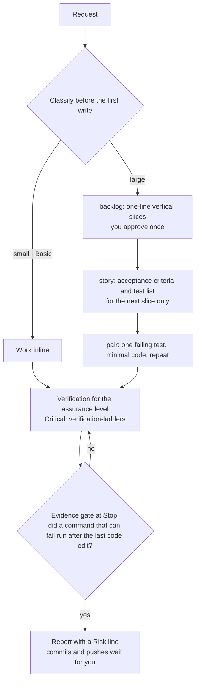
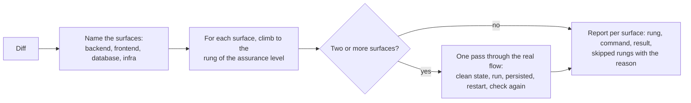
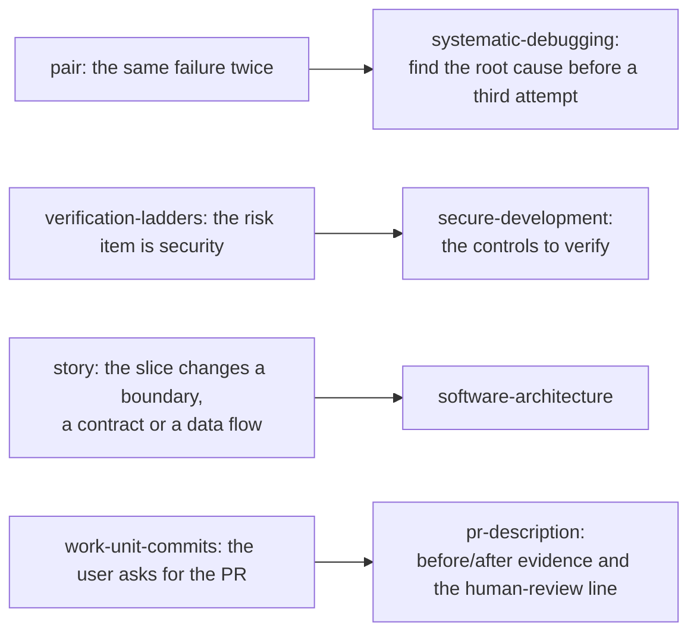
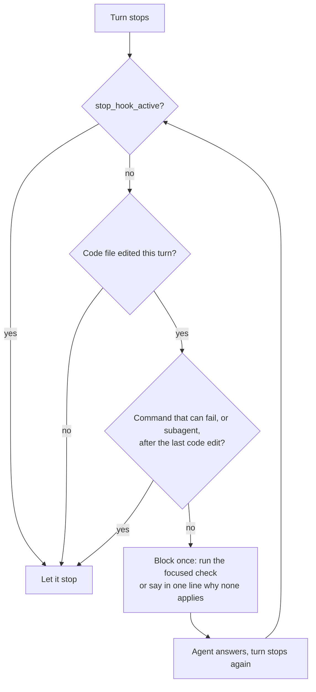
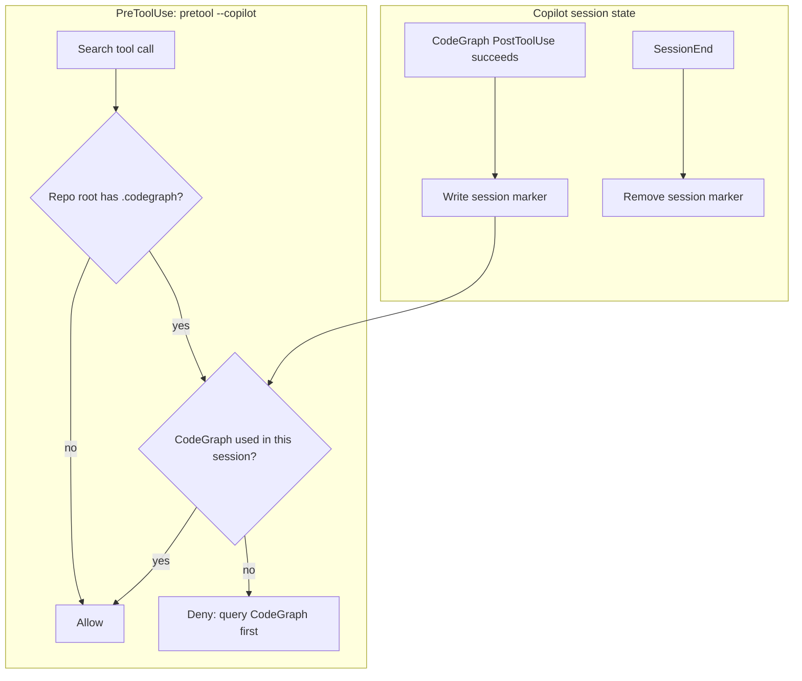
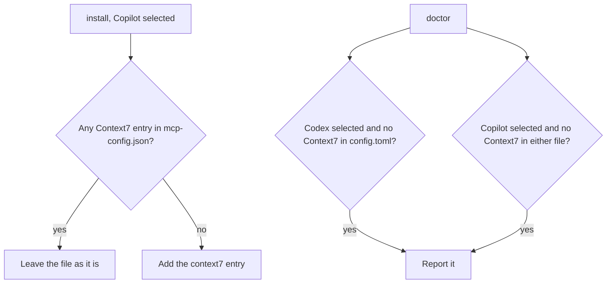
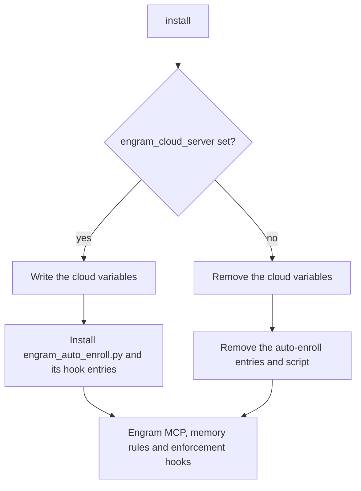

# Methodology

This file explains why each rule of the harness exists and how it works. It grows slice by slice.

## How the pieces fit

The harness runs inside the agent apps (the Claude app's Code tab, the Codex app, Copilot in VS Code) as instructions, skills, subagents, and hooks. It does not run the model and needs no API key. This is the path a change takes:

Each section below covers one of these pieces.

## One classifier

### Why

The agent used to decide the process in two places. Slice Flow sized the work (small or large), a separate rule picked the assurance level (Basic, Standard, Critical), and the list of risk items only appeared in the closing Risk line, after the work was done. A risk found at the end raised assurance too late to change how the work was built.

Process should scale with risk: a label change must not pay for the ceremony of a migration, and a migration must not get the checks of a label change. There is no solid evidence that more process always gives better results. The one study that measures process discipline directly, RigorBench ([arXiv 2606.22678](https://arxiv.org/abs/2606.22678)), was written by the authors of the framework it favors, uses one model and an LLM judge, and reports different figures between versions. So the harness adds process only where the risk calls for it.

### How

Step 2 of Slice Flow (`core/instructions/09-slice-flow.md`) is now "Classify before the first write". It decides both things at once, and the risk items are listed there and nowhere else:

| Question | Answer | Effect |
|---|---|---|
| Does one bounded look explain it, with no risk item, finishable from the request plus `git diff`? | small | work inline, no backlog or story |
| Otherwise | large | backlog, then story and pair per slice |
| Does it touch a risk item? (irreversible data or migrations, security, contracts others consume, concurrency, deploy or environment config, no test that would catch a regression) | Critical | Critical rungs of `verification-ladders`, one independent review |
| Non-trivial behavior or integration, no risk item | Standard | the smallest useful regression check |
| Bounded and reversible | Basic | one focused check and a diff readback |

The agent states the class in one line (`Class: large · Critical (migration)`) unless the work is small and Basic. The closing Risk line names the same item; an item found along the way raises assurance to Critical before closing. `core/instructions/05-change-safety-delivery-evidence.md` only says what each level requires.

## Verification ladders

### Why

"Run the applicable critical checks" did not say which checks. Unit tests alone give false confidence on full-stack work: in MACBench, application logic that spans turns was the largest group of unresolved errors, 33–50% of them, and repair from runtime feedback helped on average while too many repair attempts made the final result worse ([ACL Anthology](https://aclanthology.org/2026.emnlp-main.2172/)).

### How

The `verification-ladders` skill (`core/skills/verification-ladders/SKILL.md`) turns a diff into a list of checks:

- Each level includes the rungs below it. The skill's table lists the rungs per surface.
- It uses the repository's own commands. A rung the repository has no tooling for is skipped and reported; the agent asks before adding a tool.
- Any migration, and any infra change that reaches production, starts at Critical.
- Mutation testing runs only for Critical changes, on the changed modules, when the repository already has the tool.
- After the same failure twice, the agent stops repairing and looks for the root cause.

## Skills that left

The harness no longer installs `performance-marketing-senior`, `seo-copy-senior`, `brand-graphic-design`, and `chained-pr`. `install` moves the installed copies to the backup folder.

- The first three are not part of building software, and every installed skill adds its description to the context of every session. `seo-copy-senior` was in use, so it was tested before staying out: the same SEO task, with and without the skill, on two models. Without it, neither model invented traffic figures, search volumes or a testimonial, which were the things the skill forbade. What the skill added was a delivery format and a habit of checking the primary source.
- `chained-pr` had no use in any of the three agents and no instruction called it. `work-unit-commits` still explains when a change should be split into chained pull requests.

## Skills that call each other

### Why

Counting real sessions showed three skills that almost never loaded in Claude Code: `systematic-debugging` (0 uses), `software-architecture` (0) and `secure-development` (1). Nothing in the instructions or in another skill sent the agent to them, so they depended on the agent remembering. Codex did load them, which shows they are useful when reached.

### How

The skill that is already loaded at the moment of need names the one that owns the problem. This costs nothing in the always-loaded instructions.

A test checks that each caller still names its target and that the target exists.

## Evidence gate

### Why

What an agent says about its own work is not evidence. In SWE-CoWork, 31% of the requirements one model reported as completed failed their tests ([arXiv 2611.20218](https://arxiv.org/abs/2611.20218)). In MACBench the best agent passed 70.6% of checklist items but completed only 10.7% of instances strictly ([ACL Anthology](https://aclanthology.org/2026.emnlp-main.2172/)). A turn that edits code and stops without running anything is a claim with nothing behind it.

The gate asks for one thing: after the last code edit, run something that can fail.

### How

The Stop hook (`core/hooks/enforce_memory_graph.py evidence`) runs when the agent tries to end a turn in Claude Code, Codex or Copilot. It reads the transcript of the current turn and decides once.

The block message says how many code files the turn edited and that no command that can fail ran after the last edit. It asks for the focused check (test, build, or the command that shows the change works) or one line explaining why none applies. On the second stop `stop_hook_active` is set, so the gate never blocks twice. If the transcript cannot be read, the hook lets the turn stop.

What counts as code: any edited file except `.md`, `.mdx`, `.txt`, `.rst`, and anything under `.slices/`. Claude Code edits come from the `Edit`, `Write`, `MultiEdit` and `NotebookEdit` tools; Codex edits come from file-change items; Copilot edits come from `apply_patch`, `create_file`, `replace_string_in_file` and `multi_replace_string_in_file`. A Copilot edit whose file path cannot be read counts as code.

What counts as verification: a shell command (`Bash`, `PowerShell`, or `run_in_terminal` in Copilot) with at least one part that is not read-only, or a subagent call (`Agent` in Claude Code, subagent activity items in Codex, `runSubagent` and `execution_subagent` in Copilot) after the last code edit. A command before the last edit does not count, since the edit may have broken what it checked. Read-only commands do not count either, because they pass whether or not the change works: `ls`, `cat`, `grep`, `git status`, `git diff` and the rest of the `READ_ONLY` list in the hook. `git status && pytest` counts, because one part can fail.

### Known limits

- It does not check that the command is a test. `ls` after an edit no longer satisfies the gate, but `python3 -c pass` does. The read-only list is a list of names, so a repo whose real check is on it answers with the one-line reason.
- Edits made through a shell command, and MCP tools that run commands, are not seen.
- Copilot is covered through its `Stop` hook, called with `--copilot`. This was checked against the VS Code Copilot extension installed on one Mac: it accepts the `Stop` event name, reads hooks from `~/.copilot/hooks`, sends `transcript_path` and `stop_hook_active`, and reads the decision only inside `hookSpecificOutput`. The transcript reader was checked against real Copilot transcripts. The hook has not yet been seen firing in a live VS Code chat, where agent hooks are in preview.

### Risk by path

The closing `Risk:` line is the agent's own call, and the same hook checks it against one fact it can see: the paths the turn edited. The idea comes from [rsc-harness](https://github.com/ericrisco/rsc-harness), where the change sets the review tier and the author does not.

`RISK_PATHS` in the hook maps path patterns to five of the risk items Slice Flow names: secrets (`.env`, `secrets/`, `*.pem`), authentication (`auth/`, `login.*`, `session_*`), payments (`billing/`, `payments/`, `stripe.*`), migrations (`migrations/`, `db/migrate/`, `alembic/versions/`), and deploy or environment config (`.github/workflows/`, `.circleci/`, `Dockerfile`, `*.tf`). When a turn edited a code file on one of them and the final message has no `Risk:` line or says `Risk: none`, the gate blocks once and names the classes it saw. Any other value passes. When the evidence check fails too, one block carries both reasons.

Paths are matched below the repository root of each edited file, so a checkout named `payments-api` does not flag every file in it. An empty `Risk:` line counts as `none`. A test checks that each class in the table appears in the Slice Flow risk sentence, so the table stays a subset of that list and never becomes a second one.

Limits:

- It reads names, not content: password hashing in `src/app.py` goes unseen. Contracts, concurrency, and missing tests cannot be seen from a path at all.
- It cannot tell whether the named item is the right one, only that the line is not `none`.
- It needs the final message. Claude Code and Codex send `last_assistant_message` in the Stop payload. VS Code's Copilot does not, so there the hook reads the last `assistant.message` of the turn from the transcript, and only when it has text and requests no tools; in the Copilot transcripts on one Mac that is how a finished turn ends. Whether that message is already written when the hook fires has not been seen in a live chat. When it is missing the check is skipped.

### Why it replaced the scope check

The scope check blocked turns that edited 5 files or 150 lines, sized from Edit and Write input it could only partly see. The evidence gate asks for what the rule above requires. Keeping both would stack two Stop prompts on the same turn, so the scope check was removed.

## CodeGraph in Copilot

### Why

Claude Code and Codex already had a hook rule: query CodeGraph before broad searches in an indexed repo. Copilot had it only as an instruction in prose. The same hook now serves all three agents, so the rule means the same thing everywhere.

### How

Copilot's `PreToolUse` payload does not include a transcript path. The hook therefore uses the documented `PostToolUse` and `SessionEnd` events to track whether CodeGraph ran in the current session. Claude Code and Codex keep their existing transcript-based check.

What counts as a search: `grep_search`, `file_search`, `semantic_search`, and `run_in_terminal` with `rg`, `grep`, `find` and similar commands. CodeGraph has no MCP server in Copilot, so using it means a terminal command that starts with `codegraph`.

### Why the memory stop hook was removed

A Stop hook used to block a turn that edited a file or made 8 or more tool calls without an Engram write. Over 14 days of Claude Code transcripts (1,586 turns) it blocked 126 times, in 71 of 352 turns with edits, and memory calls appeared in 83% of turns with one to three edits. Saving is now an instruction: once, when non-trivial work closes.

### Limits

- VS Code only. The Copilot CLI sends its events in another shape; these hooks ignore them and allow everything.
- `doctor` reports Copilot hook execution as unverified. Verify it by selecting Copilot in VS Code, running a disposable session that uses a harmless tool, and checking the [Agent Debug Logs](https://code.visualstudio.com/docs/agents/agent-troubleshooting/chat-debug-view#_logs-view). Hook configuration and synthetic payload tests do not prove live execution.
- Copilot records CodeGraph use after a successful `PostToolUse` result. For shell tools, it also rejects the nonzero exit suffix observed in the current runtime. The public hook schema does not guarantee that suffix, so other provider output formats remain unverified.
- Copilot may run hooks for parallel tool calls concurrently. A search issued in the same batch as a CodeGraph command can be denied before the command records its completion.
- The repo root comes from the event's `cwd`, or the hook's working directory if the event has none. If VS Code starts hooks outside the workspace, the CodeGraph rule does not fire. In a workspace with several folders, another folder's index can deny a search once; one `codegraph` command in the terminal lifts it. The command has to start the terminal line (`codegraph explore ...`, not `npx codegraph ...`).
- CodeGraph indexes recognized source extensions, not every file in the repo. It excludes the extensionless `bin/harness`; use a targeted `rg` search and `view` range for that executable instead of assuming it appears in the graph.

## Context7 before library code

### Why

Agents write library and API calls from memory, and memory can be out of date. Context7 serves current documentation for a library, so the call matches the version in use. In the sessions measured on one Mac, the three agents already called Context7 without being told to (54 calls in Claude Code, 182 in Copilot, 380 in Codex); the rule makes that habit explicit.

### How

One rule in Quality Guardrails, loaded in every session: before writing code against a library, framework, SDK, CLI, or cloud API, read its current documentation with Context7, and when Context7 is unavailable, use the official documentation and say so.

Each agent gets the server from a different place:

| Agent | Where Context7 comes from | What the harness does |
| --- | --- | --- |
| Claude Code | claude.ai connector | Nothing: no local file shows it |
| Codex | `mcp_servers` in `~/.codex/config.toml` | `doctor` reports it when missing |
| Copilot | `~/.copilot/mcp-config.json` or VS Code's user `mcp.json` | `install` adds it to the first file when neither has it; `doctor` reports it when neither has it |

One check decides "has Context7": an entry whose name contains `context7`, or whose `url` is on `context7.com`. `install` and `doctor` share it, so an existing `io.github.upstash/context7` entry is never duplicated. The entry `install` writes is `{"type": "http", "url": "https://mcp.context7.com/mcp", "tools": ["*"]}`.

### Limits

- No hook. Nothing can tell deterministically that an agent is about to use a library, so the rule is instructions only.
- Claude Code is not verified: `doctor` stays silent for it, because a warning would be false on every run for people who have the connector.
- No API key is written. Context7 works without one, and the harness never writes a secret into an MCP file.

## Engram cloud is optional

### Why

Engram and CodeGraph are required by the rules: the memory rule and the code-graph check apply on every PC. The cloud sync is a different thing. It needs a server and a token, and only some PCs have them. The auto-enroll hook (`engram_auto_enroll.py`) does one job: it enrolls projects for that sync. On a PC with no server it runs on every Stop and SessionStart and does nothing useful, so it is not installed there.

### How

One switch, `engram_cloud_server` in `~/.agent-harness/config.toml`, controls all of the sync. With it set, `install` writes the `ENGRAM_CLOUD_SERVER` and `ENGRAM_CLOUD_AUTOSYNC` variables and installs the auto-enroll script and its hook entries for Claude Code and Codex. Without it, `install` writes none of those, and removes any that an earlier install left, the same way it clears any file the repo stopped shipping. The standalone `--agent codex` mode follows the same rule. The memory rules, the `stop` and `pretool` hooks, and the Engram MCP registration do not depend on the switch.

## Instruction size

### Why

Every agent loads the instructions in `core/instructions/` in every session, so each sentence there is paid for in every turn. Evidence and vendor guidance point the same way:

- Following many instructions at once gets harder as their number grows. In IFScale the best models reach only 68% accuracy at 500 simultaneous instructions ([arXiv 2507.11538](https://arxiv.org/abs/2507.11538)). That is a synthetic task on 2025 models, so it shows a trend, not a threshold.
- Claude Code's documentation asks to "target under 200 lines per CLAUDE.md file" because longer files "reduce adherence" ([memory](https://code.claude.com/docs/en/memory)), and says "If something has to happen every time, make it a hook" ([best practices](https://code.claude.com/docs/en/best-practices)).
- Agents change code that needs no change: in FixedBench they propose unwanted changes in 35 to 65% of tasks where nothing had to change ([arXiv 2605.07769](https://arxiv.org/abs/2605.07769)). In another benchmark, removing an explicit consent declaration raised out-of-scope actions from 0.0% to 17.1% ([arXiv 2605.18583](https://arxiv.org/abs/2605.18583)).

No controlled study comparing hooks with written rules was found, so the split below follows the vendors' guidance, not a measurement.

### How

The instructions state each obligation once, in the section where it belongs, and spend one clause on what a hook already enforces:

| Before | After |
|---|---|
| Commit and push approval stated five times | Once, in Slice Flow's pace step |
| Commit format, worktree placement and forbidden CodeGraph commands explained at length | One clause each; the guard's own message carries the rest |
| "Before saying done, call `mem_session_summary`" | Removed: the Engram server says ordinary completion does not need it |
| Save memory "after any decision, bugfix, discovery" | Save once when non-trivial work closes: verified durable conclusions, grouped by topic |
| Backlog file layout and the test-by-test mechanics inside Slice Flow | Left to the `backlog` and `pair` skills, which load when needed |
| (nothing) | "No change is a valid outcome": when the code already does what was asked, say so and change nothing |

Rendered size per agent went from about 22,800 characters (3,300 words, 199 lines) to about 19,900 (2,900 words, 167 lines). A later pass removed the worktree placement rule, which the guard enforces with a message that names the right folder, and brought the largest render to about 20,300. A test keeps each agent's instructions under 20,350 characters so they do not grow back unnoticed.

Rules a hook enforces on frequent actions keep their one clause: the commit format and the CodeGraph order. Without it the agent learns the rule from a denied call in every session, which costs more than the sentence.

Architecture, security, dependency, documentation and anti-slop guidance stay as skills that load on demand, which is what the vendors recommend for specialized guidance.

### Limits

- The trim is 13%, not more: what remains are distinct rules, and going lower means dropping rules.
- No test can show that the agent follows the shorter text better. The signal available without running agents headless is how often the hooks block or deny in real sessions, counted before and after; `bin/harness stats` counts it.

## Measuring the harness

### Why

A rule that never fires and a rule that fires on every turn both need a second look, and a test suite shows neither. The work here happens inside the apps, on subscriptions, so a headless agent run cannot be the measuring tool. The record of real sessions is already on disk.

### How

`bin/harness stats` reads the Claude Code transcripts under `~/.claude/projects` and prints one column per week:

- `turns`: prompts the user typed, slash commands and `!` commands included. Task notifications, reminders, and interruptions the app writes as user entries are not counted and do not end a turn.
- `code turns`: turns that edited a code file, by the evidence gate's own definition of code, and under it how many closed with a `Risk:` line in their last message.
- `denied <rule>`: tool calls a PreToolUse hook denied.
- `stopped <rule>`: turns a Stop hook blocked.

Rules are grouped by the label their reason text opens with: `CodeGraph primero`, `Evidencia`, `Riesgo`, and `Regla global:` plus its first clause. No list of rules is hardcoded, so a hook removed in an earlier commit still shows in the weeks before its removal. On the Mac where this was written, the memory Stop hook blocked about ten turns a week until the commit that removed it.

### Limits

- The transcript format is undocumented. The command reads it as Claude Code 2.1.x writes it: a denial is an errored tool result that starts with `PreToolUse:<tool> hook error:`, and a Stop block is a user entry that starts with `Stop hook feedback:`.
- An `ask` that the user approved leaves no hook trace, so the report shows what the guards stopped and not what they asked about.
- Codex and Copilot sessions are not read.
- A count says how often a rule fired, not whether it was right to fire.
- A code turn without a `Risk:` line is not always a miss: the line closes a code change, and a change can span several turns. Edits made by subagents sit in their own transcripts and are not counted.

## Considered and not done

| Idea | Decision | Reason |
|---|---|---|
| A runtime of our own that runs the model | Dropped | It needs API keys or the vendors' command-line tools; the work here happens inside the apps, on subscriptions. Two versions were built and discarded before any commit. |
| A/B evals of a skill | Not now | [rsc-harness](https://github.com/ericrisco/rsc-harness) runs them inside a Claude Code session with a workflow, so headless mode is no longer the blocker there; it still is for Codex and Copilot. Each run spends about four agents per skill and scenario, and its rubric has to come from the expected outcome and not from the skill text, or the result is circular. Deferred until `harness stats` shows which skill is worth measuring. |
| Removing the standalone `--agent codex` mode | Dropped | It is about 65 lines and does things the normal mode does not: it registers the Engram and CodeGraph MCP servers, keeps self-contained hooks under `~/.codex/hooks`, and runs the runtime checks. |
| Removing `core/retired.txt` | Later | Every PC has to run `install` once first, or its old copies are never cleaned. |
