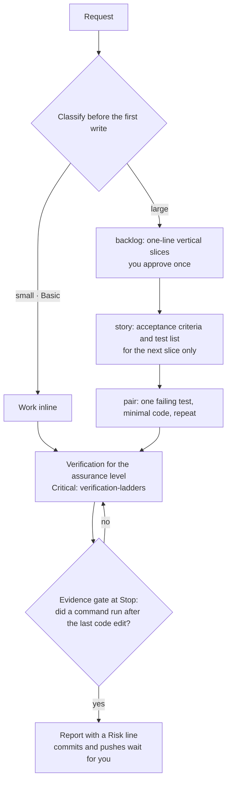
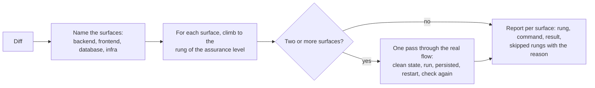
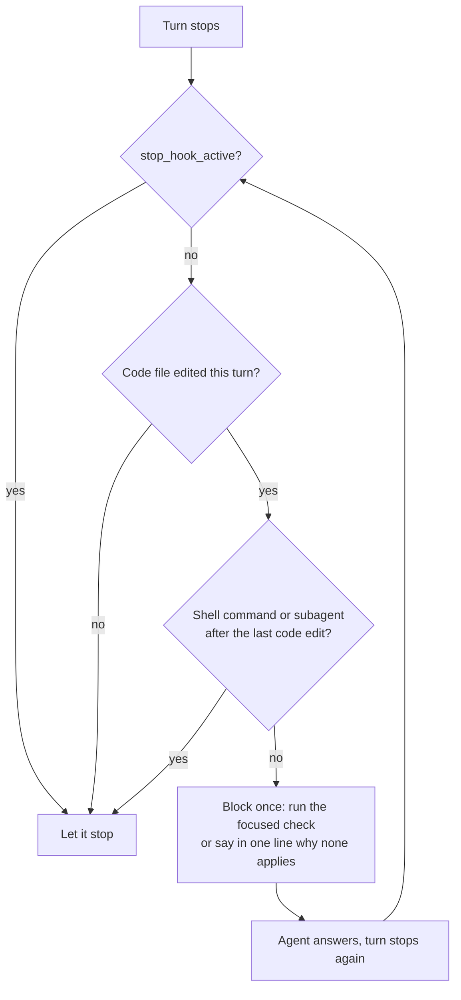
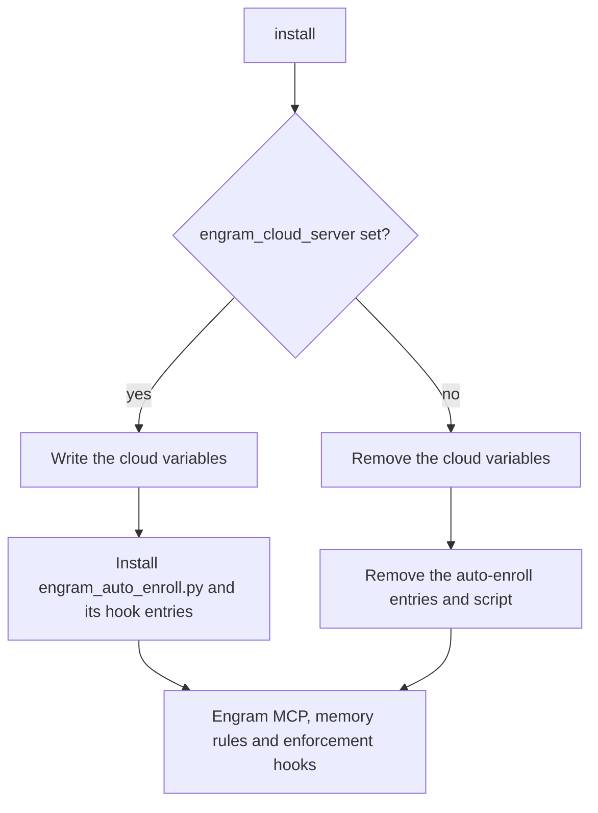

# Methodology

This file explains why each rule of the harness exists and how it works. It grows slice by slice.

## How the pieces fit

The harness runs inside the agent apps (the Claude app's Code tab, the Codex app, Copilot in VS Code) as instructions, skills, subagents, and hooks. It does not run the model and needs no API key. This is the path a change takes:

Each section below covers one of these pieces.

## One classifier

### Why

The agent used to decide the process in two places. Slice Flow sized the work (small or large), a separate rule picked the assurance level (Basic, Standard, Critical), and the list of risk items only appeared in the closing Risk line, after the work was done. A risk found at the end raised assurance too late to change how the work was built.

Process should scale with risk: a label change must not pay for the ceremony of a migration, and a migration must not get the checks of a label change. There is no solid evidence that more process always gives better results. The one study that measures process discipline directly, RigorBench ([arXiv 2606.22678](https://arxiv.org/abs/2606.22678)), was written by the authors of the framework it favors, uses one model and an LLM judge, and reports different figures between versions. So the harness adds process only where the risk calls for it.

### How

Step 2 of Slice Flow (`core/instructions/09-slice-flow.md`) is now "Classify before the first write". It decides both things at once, and the risk items are listed there and nowhere else:

| Question | Answer | Effect |
|---|---|---|
| Does one bounded look explain it, with no risk item, finishable from the request plus `git diff`? | small | work inline, no backlog or story |
| Otherwise | large | backlog, then story and pair per slice |
| Does it touch a risk item? (irreversible data or migrations, security, contracts others consume, concurrency, delivery or environment, no test that would catch a regression) | Critical | Critical rungs of `verification-ladders`, one independent review |
| Non-trivial behavior or integration, no risk item | Standard | the smallest useful regression check |
| Bounded and reversible | Basic | one focused check and a diff readback |

The agent states the class in one line (`Class: large · Critical (migration)`) unless the work is small and Basic. The closing Risk line names the same item; an item found along the way raises assurance to Critical before closing. `core/instructions/05-change-safety-delivery-evidence.md` only says what each level requires.

## Verification ladders

### Why

"Run the applicable critical checks" did not say which checks. Unit tests alone give false confidence on full-stack work: in MACBench, application logic that spans turns was the largest group of unresolved errors, 33–50% of them, and repair from runtime feedback helped on average while too many repair attempts made the final result worse ([ACL Anthology](https://aclanthology.org/2026.emnlp-main.2172/)).

### How

The `verification-ladders` skill (`core/skills/verification-ladders/SKILL.md`) turns a diff into a list of checks:

- Each level includes the rungs below it. The skill's table lists the rungs per surface.
- It uses the repository's own commands. A rung the repository has no tooling for is skipped and reported; the agent asks before adding a tool.
- Any migration, and any infra change that reaches production, starts at Critical.
- Mutation testing runs only for Critical changes, on the changed modules, when the repository already has the tool.
- After the same failure twice, the agent stops repairing and looks for the root cause.

## Skills that left

The harness no longer installs `performance-marketing-senior`, `seo-copy-senior`, and `brand-graphic-design`. They are not part of building software, and every installed skill adds its description to the context of every session. `install` moves the installed copies to the backup folder.

## Evidence gate

### Why

What an agent says about its own work is not evidence. In SWE-CoWork, 31% of the requirements one model reported as completed failed their tests ([arXiv 2611.20218](https://arxiv.org/abs/2611.20218)). In MACBench the best agent passed 70.6% of checklist items but completed only 10.7% of instances strictly ([ACL Anthology](https://aclanthology.org/2026.emnlp-main.2172/)). A turn that edits code and stops without running anything is a claim with nothing behind it.

The gate asks for one thing: after the last code edit, run something that can fail.

### How

The Stop hook (`core/hooks/enforce_memory_graph.py evidence`) runs when the agent tries to end a turn in Claude Code, Codex or Copilot. It reads the transcript of the current turn and decides once.

The block message says how many code files the turn edited and that no command ran after the last edit. It asks for the focused check (test, build, or the command that shows the change works) or one line explaining why none applies. On the second stop `stop_hook_active` is set, so the gate never blocks twice. If the transcript cannot be read, the hook lets the turn stop.

What counts as code: any edited file except `.md`, `.mdx`, `.txt`, `.rst`, and anything under `.slices/`. Claude Code edits come from the `Edit`, `Write`, `MultiEdit` and `NotebookEdit` tools; Codex edits come from file-change items; Copilot edits come from `apply_patch`, `create_file`, `replace_string_in_file` and `multi_replace_string_in_file`. A Copilot edit whose file path cannot be read counts as code.

What counts as verification: any shell command (`Bash`, `PowerShell`, or `run_in_terminal` in Copilot) or subagent call (`Agent` in Claude Code, `runSubagent` and `execution_subagent` in Copilot) after the last code edit. A command before the last edit does not count, since the edit may have broken what it checked.

### Known limits

- It does not check that the command is a test. `ls` after an edit satisfies the gate. The gate asks for evidence to exist, not for proof that it is good.
- Edits made through a shell command, and MCP tools that run commands, are not seen.
- Codex subagent calls are not seen: a Codex turn that edits code and leaves every check to a subagent is asked once.
- Copilot is covered through its `Stop` hook, called with `--copilot` because VS Code reads the decision inside `hookSpecificOutput`. The transcript reader was checked against real Copilot transcripts on one Mac (edits, terminal commands and subagent calls all resolved), but the hook has not been tested firing inside VS Code itself, where agent hooks are in preview.

### Why it replaced the scope check

The scope check blocked turns that edited 5 files or 150 lines, sized from Edit and Write input it could only partly see. The evidence gate asks for what the rule above requires. Keeping both would stack two Stop prompts on the same turn, so the scope check was removed.

## Engram cloud is optional

### Why

Engram and CodeGraph are required by the rules: the memory and code-graph checks run on every PC. The cloud sync is a different thing. It needs a server and a token, and only some PCs have them. The auto-enroll hook (`engram_auto_enroll.py`) does one job: it enrolls projects for that sync. On a PC with no server it runs on every Stop and SessionStart and does nothing useful, so it is not installed there.

### How

One switch, `engram_cloud_server` in `~/.agent-harness/config.toml`, controls all of the sync. With it set, `install` writes the `ENGRAM_CLOUD_SERVER` and `ENGRAM_CLOUD_AUTOSYNC` variables and installs the auto-enroll script and its hook entries for Claude Code and Codex. Without it, `install` writes none of those, and removes any that an earlier install left, the same way it clears any file the repo stopped shipping. The standalone `--agent codex` mode follows the same rule. The memory rules, the `stop` and `pretool` hooks, and the Engram MCP registration do not depend on the switch.

## Considered and not done

| Idea | Decision | Reason |
|---|---|---|
| A runtime of our own that runs the model | Dropped | It needs API keys or the vendors' command-line tools; the work here happens inside the apps, on subscriptions. Two versions were built and discarded before any commit. |
| A/B evals of the harness itself | Not now | They need the agents in headless mode as a measuring tool. |
| Removing the standalone `--agent codex` mode | Dropped | It is about 65 lines and does things the normal mode does not: it registers the Engram and CodeGraph MCP servers, keeps self-contained hooks under `~/.codex/hooks`, and runs the runtime checks. |
| Removing `core/retired.txt` | Later | Every PC has to run `install` once first, or its old copies are never cleaned. |
